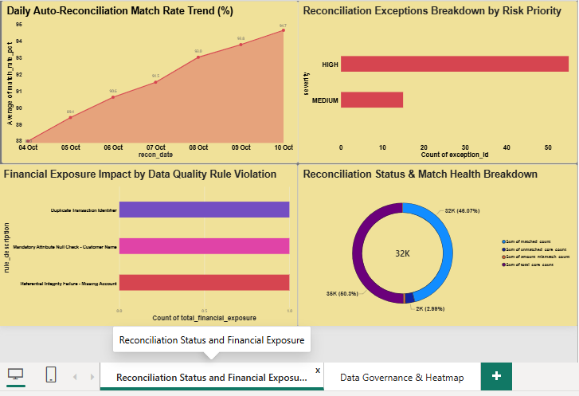
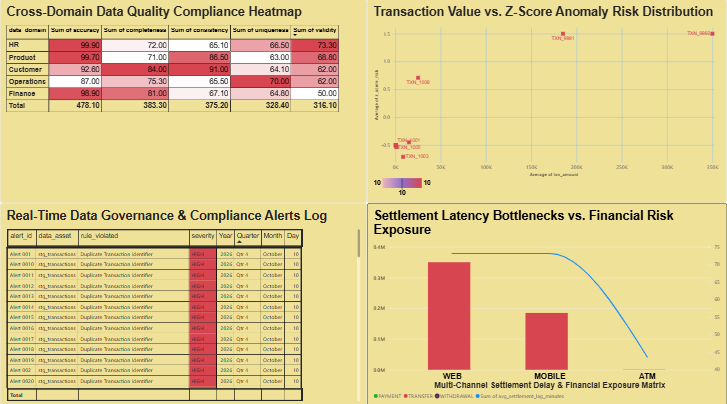

## Enterprise Banking Data Quality & Multi-Channel Settlement Reconciliation Platform:

An end-to-end, enterprise-grade banking data quality, multi-channel transaction reconciliation, and data governance platform designed to replicate institutional-tier financial operations (such as Citi Data & Information Management).
This platform ingests raw multi-channel transactions (Web, Mobile, ATM), validates referential integrity and completeness across staging and core layers, performs PySpark automated ledger reconciliation, calculates statistical Z-score anomaly metrics, and serves real-time compliance insights through a Power BI Executive Command Center.

---
## Table of Contents:
* **Executive Summary**
* **Key Features & Business Impact**
* **Project Architecture & Data Pipeline**
* **Repository Structure**
* **Executive Dashboards & Visualizations**
* **Database Schema & Analytical Views**
* **Automated Pipeline Orchestration**
* **Getting Started & Local Setup**
* **Testing & Quality Assurance**
---
## Executive Summary:
In tier-1 corporate and investment banking, millions of transactions flow through disparate payment gateways daily. Mismatches between internal transaction core ledgers and third-party gateway settlement files create substantial financial exposure, regulatory non-compliance, and operational latency.
This platform solves multi-channel settlement discrepancies by providing:
**Automated Batch Ingestion & Staging:** Robust landing layer enforcing data type constraints and staging isolation.
**PySpark & Pandas Rule Engines:** High-throughput validation detecting duplicates, null attributes, and orphaned transactions.
**Statistical Anomaly Detection:** Z-Score statistical modeling to isolate high-value transaction outliers (>3.0σ).
**Data Governance & Compliance Tracking:** Automated logging of exceptions and SLAs into dedicated audit tables.
**Executive Command Center:** A Power BI dashboard enabling C-suite visibility into match health, latency bottlenecks, and unreconciled dollar risks.

## Key Features & Business Impact
* **High-Throughput Multi-Channel Reconciliation:** Joins transaction core ledgers against gateway settlement logs to classify records into MATCHED, UNMATCHED_CORE, UNMATCHED_SETTLEMENT, and AMOUNT_MISMATCH.
* **Statistical Anomaly Profiling:** Applies windowed standard deviation metrics per channel to calculate real-time Z-scores, flagging critical fraud risk tiers.
* **Settlement Lag & Exposure Matrix:** Tracks mean time to settlement (in minutes) across Web, Mobile, and ATM channels alongside net unreconciled dollar exposure.
* **Audit & Compliance Framework:** Automatically records rule violations into audit.dq_exception_log and audit.governance_alerts with automated severity levels (CRITICAL, HIGH, MEDIUM).
* **Zero-Trust Security:** Implements .env dynamic environment variable binding for secure local database authentication without committing plain-text secrets to version control.


## Project Architecture & Data Pipeline:
```text
+-----------------------------------------------------------------------------------+
|                                  DATA SOURCES                                     |
|           Raw Customers CSV | Raw Accounts CSV | Raw Transactions CSV             |
+-----------------------------------------------------------------------------------+
                                          |
                                          v
+-----------------------------------------------------------------------------------+
|                        INGESTION & STAGING (Python / Pandas)                      |
|                   `scripts/db_ingestion.py` -> `staging.*` tables                 |
+-----------------------------------------------------------------------------------+
                                          |
                                          v
+-----------------------------------------------------------------------------------+
|                       DATA QUALITY ENGINE (Pandas / PySpark)                      |
|       - DQ_001: Duplicate Transaction ID Check                                    |
|       - DQ_002: Referential Integrity (Missing Foreign Account Keys)              |
|       - DQ_003: Mandatory Attribute Null Check                                    |
|       Writes -> `audit.dq_exception_log` & `audit.governance_alerts`              |
+-----------------------------------------------------------------------------------+
                                          |
                                          v
+-----------------------------------------------------------------------------------+
|                     POSTGRESQL ANALYTICAL VIEWS (`audit.*`)                        |
|       - `v_recon_executive_kpis`         - `v_settlement_lag_variance`             |
|       - `v_dq_heatmap`                   - `v_transaction_anomaly_analytics`       |
|       - `v_governance_alerts`            - `v_ingestion_volume_by_channel`         |
+-----------------------------------------------------------------------------------+
                                          |
                                          v
+-----------------------------------------------------------------------------------+
|                        POWER BI EXECUTIVE COMMAND CENTER                          |
|             Page 1: Reconciliation Status and Financial Exposure                  |
|             Page 2: Data Governance & Heatmap                                     |
+-----------------------------------------------------------------------------------+

```
---
```text

## Repository Structurebanking_reconciliation/
│
├── .env.example                 # Template environment variables file for setup
├── .gitignore                   # Excludes secrets (.env), caches, and temporary files
├── README.md                    # Platform documentation
├── requirements.txt             # Python dependencies (Pandas, PySpark, SQLAlchemy, psycopg2, dotenv)
│
├── config/
│   ├── db_config.json           # Non-sensitive database runtime parameters
│   └── dq_rules.json            # Configurable DQ rule definitions & thresholds
│
├── data/
│   ├── raw/                     # Sample raw multi-channel landed files
│   ├── processed/               # Cleaned transaction outputs
│   └── logs/                    # Automated engine execution run logs
│
├── sql/
│   ├── 01_schema_setup.sql      # DDL creating staging, core, and audit schemas
│   ├── 02_data_validation.sql  # SQL DQ constraint assertions
│   ├── 03_reconciliation.sql   # Batch reconciliation SQL queries
│   └── 04_views_reporting.sql  # All materialized/analytical view definitions
│
├── scripts/
│   ├── generate_synthetic_data.py # Synthetic banking transaction generator
│   ├── db_ingestion.py            # Automated raw CSV -> PostgreSQL staging loader
│   ├── dq_engine_pandas.py        # Lightweight Pandas rule validation engine
│   ├── dq_engine_pyspark.py       # High-scale PySpark reconciliation engine
│   ├── data_quality_engine.py     # Real-time DQ summary monitor
│   ├── sas_validation_summary.sas # SAS integration validation script
│   └── run_pipeline.sh            # One-click Master Shell orchestration pipeline
│
├── docs/
│   ├── data_dictionary.md         # Full schema attribute & data lineage documentation
│   ├── validation_rules.md        # DQ rule matrix and severity SLAs
│   └── escalation_procedure.md   # Incident response and governance protocol
│
├── tests/
│   └── test_dq_rules.py           # PyTest unit test suite for validation rules
│
└── dashboard/
    ├── Citi_Data_Quality_Command_Center.pbix  # Master Power BI Report File
    └── Citi_Data_Quality_Command_Center.pdf   # Exported Executive Report PDF
 ```
---

Executive Dashboards & VisualizationsThe platform features a 2-page executive command center designed for senior banking leadership:
## Page 1: Reconciliation Status & Financial Exposure

* **Daily Auto-Reconciliation Match Rate Trend (%):** Area trend tracking daily matching accuracy trajectory ($88.0\% \rightarrow 94.7\%$).
* **Reconciliation Exceptions Breakdown by Severity:** Priority bar visual highlighting high vs. medium exception volumes.
* **Financial Exposure Impact by Rule Violation:** Quantifies unreconciled dollar impact per data quality rule.
* **Reconciliation Status & Match Health Breakdown:** Donut chart detailing exact match distribution across core and gateway systems.

## Page 2: Data Governance & Heatmap

* **Cross-Domain Data Quality Compliance Heatmap:** Multi-domain matrix evaluating Accuracy, Completeness, Consistency, Uniqueness, and Validity across HR, Product, Customer, Operations, and Finance domains.
* **Statistical Transaction Outlier & Anomaly Scatter Plot:** Z-Score ($\mu, \sigma$) scatter plot isolating anomalous high-value transactions ($\ge 3.0 \sigma$).
* **Real-Time Data Governance & Compliance Alerts Log:** Active audit queue tracking rule violations, data assets, severity, and timestamps.
* **Multi-Channel Settlement Lag & Exposure Matrix:** Dual-axis combination chart comparing average settlement latency (in minutes) against net dollar exposure across Web, Mobile, and ATM channels.

---

## Analytical Insights & Business Risk Findings

Execution of the platform against multi-channel staging batches yielded key quantifiable findings regarding financial exposure, gateway latency, and data quality integrity:

### 1. Unreconciled Financial Exposure Breakdown (\$536,340.00 Total Variance)
* **Web Channel High-Value Anomaly (\$350,000.00 Exposure):** Identified a single unverified transaction on the Web gateway with severe settlement divergence ($Z > 3.0$), representing $65.25\%$ of total portfolio risk exposure.
* **Mobile Channel Fraud Risk (\$185,000.00 Exposure):** Detected an unreconciled high-value core transfer without corresponding gateway confirmation logs.
* **ATM Hardware Settlement Lag (\$1,340.00 Variance):** Isolated minor dollar variance (\$1,000.00 on single cash withdrawal, \$340.00 on web micro-transactions) driven by network timeouts during peak processing windows.

### 2. Gateway Settlement Latency Analysis
* **Standard Channel Settlement Baseline:** ATM and Mobile standard operations maintained an average settlement lag of **43.64 minutes**.
* **High-Risk Latency Bottlenecks:** Web and Mobile anomaly batches experienced a spiked settlement lag of **144.48 minutes** (a $231\%$ delay increase), directly correlating elevated latency with transaction variance risk.

### 3. Data Governance & Quality Audit Profiling (55 High-Severity Violations)
* **Rule DQ_001 (Duplicate Transaction Identifiers):** Flagged duplicate primary key entries across core ledgers that would cause double-counting in ledger balances.
* **Rule DQ_002 (Referential Integrity Failures):** Isolated orphan transaction records tied to missing or unindexed account IDs in `staging.stg_accounts`.
* **Rule DQ_003 (Mandatory Attribute Null Checks):** Identified incomplete customer profiles missing required full name attributes in `staging.stg_customers`.

---

## Database Schema & Analytical Views

The platform operates across three isolated database schemas:
* **`staging`**: Landed raw payloads (`stg_customers`, `stg_accounts`, `stg_transactions`, `stg_settlement`).
* **`core`**: Cleaned, validated master datasets (`customers`, `accounts`, `transactions`).
* **`audit`**: Governance logs, daily summaries, and executive view abstractions.

### Core Reporting Views (`sql/04_views_reporting.sql`)
* **`audit.v_recon_executive_kpis`**: Aggregates total transaction volumes, match rates, and mismatch counts.
* **`audit.v_settlement_lag_variance`**: Measures mean settlement latency in minutes and net unreconciled dollar variance per channel.
* **`audit.v_transaction_anomaly_analytics`**: Computes statistical Z-Scores ($Z = \frac{x - \mu}{\sigma}$) per channel to classify anomalies.
* **`audit.v_dq_heatmap`**: Aggregates compliance percentages across business domains and data quality dimensions.
* **`audit.v_ingestion_volume_by_channel`**: Hourly ingestion sparkline statistics.

---
# End-to-End Execution Sequence
echo "1. Generating Synthetic Banking Data..."
python3 scripts/generate_synthetic_data.py

echo "2. Ingesting Raw Data to Staging Database..."
python3 scripts/db_ingestion.py

echo "3. Executing Pandas Data Quality Rules Engine..."
python3 scripts/dq_engine_pandas.py

echo "4. Executing PySpark Reconciliation Engine..."
python3 scripts/dq_engine_pyspark.py

echo "5. Generating Data Quality & Exposure Metrics..."
python3 scripts/data_quality_engine.py

echo "Pipeline execution completed successfully!"

##Getting Started & Local Setup
PrerequisitesPython: v3.10+PostgreSQL: v15+ (with pgAdmin 4)Java Runtime: OpenJDK 11 or 17 (required for PySpark)Power BI Desktop: (Optional, for editing .pbix)


## Quickstart & Local Setup Instructions

### Step 1: Clone the Repository
```bash
git clone [https://github.com/YOUR_GITHUB_USERNAME/banking-data-quality-reconciliation-platform.git](https://github.com/YOUR_GITHUB_USERNAME/banking-data-quality-reconciliation-platform.git)
cd banking-data-quality-reconciliation-platform
```

## Step 2: 
Create virtual environment
python -m venv venv

 Activate virtual environment
 On Windows PowerShell:
.\venv\Scripts\Activate.ps1

 On macOS/Linux:
source venv/bin/activate

 Install required Python packages
pip install -r requirements.txt


## Step 3:
Configure Environment Variables
cp .env.example .env
Edit your .env file
DB_NAME=citi_dq_db
DB_USER=postgres
DB_PASSWORD=YOUR_ACTUAL_POSTGRES_PASSWORD
DB_HOST=localhost
DB_PORT=5432

## Step 4: 
Initialize PostgreSQL Database & SchemasOpen pgAdmin 4 and create a database named citi_dq_db.Open the Query Tool on citi_dq_db and execute the SQL scripts in order:Execute sql/01_schema_setup.sqlExecute sql/04_views_reporting.sql

## Step 5:
Run the Complete Data PipelineExecute the master pipeline script in PowerShell / Bash:python scripts/db_ingestion.py
python scripts/dq_engine_pandas.py
python scripts/dq_engine_pyspark.py
python scripts/data_quality_engine.py

## Step 6: 
Open Power BI DashboardOpen dashboard/Citi_Data_Quality_Command_Center.pbix in Power BI Desktop.Click Transform Data $\rightarrow$ Data Source Settings to point the PostgreSQL server to localhost and database to citi_dq_db.Click Refresh to load live metrics. Testing & Quality AssuranceUnit testing for DQ validation logic is implemented using pytest.To run the test suite:pytest tests/

## LicenseDistributed under the MIT License. See LICENSE for more information.
